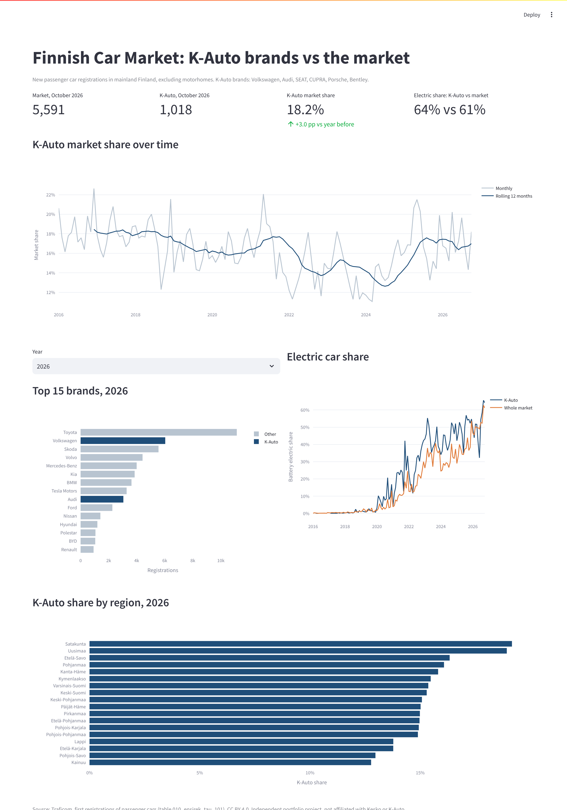

# Finnish Car Market: K-Auto brands vs the market

An end-to-end BI project on Traficom's open data: new passenger car registrations in
Finland, 2016 to today, with a focus on the brands imported by K-Auto
(Volkswagen, Audi, SEAT, CUPRA, Porsche, Bentley).

**Python ingestion → DuckDB → dbt models with data tests → Streamlit dashboard → GitHub Actions CI**



## Key findings

| | |
|---|---|
| K-Auto market share | 18.4% (2016) → about 14% (2022–2024) → **17.4% (2025)** |
| Largest brands, 2025 | Toyota 16.1% · Volkswagen 11.3% · Škoda 10.0% · Volvo 8.3% |
| Electric share, Oct 2026 | **64% of K-Auto registrations** vs 61% of the market |
| Market size | 119,000 cars (2016) → 72,000 (2025) |

Figures exclude motorhomes; see below.

## Data quality: making the numbers match

Traficom publishes its own totals next to the detail rows. Three rules reconcile them
exactly, and each one is a dbt test that fails the build if it breaks:

| Check | Rule | dbt test |
|---|---|---|
| Brands vs total | Brands + "other brands" + **motorhomes** = total. Motorhomes (~1,300 a year) are in the total but in no brand row, so a plain sum of brands is always short. | `assert_brands_reconcile_to_reported_total` |
| Power sources vs total | Petrol + diesel + electric + … = total | `assert_power_sources_reconcile` |
| Regions vs mainland Finland | 18 regions + "unknown" + "abroad" = mainland Finland (Åland is not in this data) | `assert_regions_reconcile` |

Market share is calculated **without motorhomes**, and shares are tested to sum to 100% every month.

## How it works

```
ingest/fetch_registrations.py   Traficom API → DuckDB raw.registrations
                                (chunked to stay under the 110,000-cell API limit; safe to re-run)
transform/ (dbt)
  seeds/        brand_groups (K-Auto brands), powertrains (code → English name, group)
  staging/      stg_registrations (detail rows), stg_reported_totals (source totals)
  marts/        dim_brand, fct_registrations, mart_brand_monthly,
                mart_k_auto_monthly, mart_region_yearly
  tests/        reconciliation, unique grain, shares sum to one   (27 tests in total)
app/dashboard.py                Streamlit + Plotly dashboard
.github/workflows/ci.yml        unit tests + live load + dbt build on every push and monthly
```

## Run it

```bash
python -m venv .venv && source .venv/bin/activate
pip install -r requirements.txt
python ingest/fetch_registrations.py          # about 2 minutes, all years
cd transform && dbt build --profiles-dir . && cd ..
streamlit run app/dashboard.py
```

Run `pytest` for the unit tests.

## How it was built

Built with AI-assisted development (Claude). Every result was checked against
Traficom's published totals, and the dbt tests keep it that way.

## Data and licence

Source: [Traficom](https://trafi2.stat.fi/PXWeb/pxweb/fi/TraFi/TraFi__Ensirekisteroinnit/),
table `010_ensirek_tau_101`, licensed CC BY 4.0. Independent portfolio project, not
affiliated with Kesko or K-Auto.
